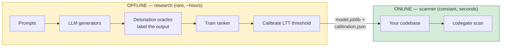
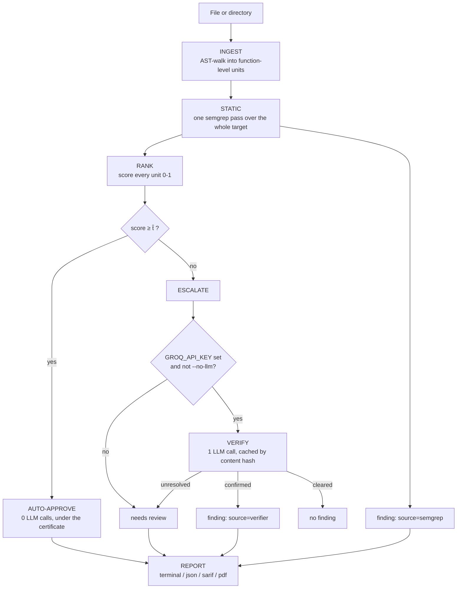

# CodeGate

**A certified-miss-rate security scanner for Python.** CodeGate escalates
code to an LLM only when it cannot mathematically prove the code is
safe — and it can tell you, with a real statistical guarantee, how often
it's wrong.

[](https://github.com/ad1tya-wq/codegate-scanner/actions/workflows/ci.yml)

---

## Table of contents

- [What CodeGate is](#what-codegate-is)
- [How it works, technically](#how-it-works-technically)
- [Quickstart](#quickstart)
- [Try it: the demo app](#try-it-the-demo-app)
- [High-level design](#high-level-design)
- [The scan pipeline](#the-scan-pipeline)
- [Current metrics](#current-metrics)
- [Future improvements](#future-improvements)
- [Project context](#project-context)

---

## What CodeGate is

Most AI-assisted code scanners force a bad trade-off. Either they're pure
static analysis — fast and free, but they miss anything that isn't a
known pattern — or they send *every* function to an LLM, which is slow,
expensive, and still just a probabilistic guess dressed up as an answer.

CodeGate does neither. It runs a cheap, deterministic pre-pass over your
code first, and only calls an LLM for the functions it genuinely cannot
vouch for. The part it *doesn't* escalate isn't a guess either — it comes
with a real, provable guarantee: **"averaged over coding tasks, at most 10%
of vulnerable functions get auto-approved, and we're 95% confident of that
bound."** That
guarantee is computed statistically, not asserted, and it holds no
matter what the underlying model looks like inside.

The result: static-analysis speed and cost for the code that's obviously
fine, LLM-level judgment reserved for the code that actually needs it,
and a number at the end you can defend instead of a vibe.

## How it works, technically

The certificate comes from **Learn-Then-Test (LTT) conformal risk
control** — a distribution-free, finite-sample method for choosing a
decision threshold with a provable risk bound. Concretely:

1. A lightweight ranker (`HashingVectorizer` + `LogisticRegression`,
   trained on labeled code samples) scores every function `0–1`, where
   higher means *safer*.
2. LTT runs fixed-sequence hypothesis testing over candidate thresholds
   `t`, where the risk `R(t) = P(score ≥ t | vulnerable)` is monotone in
   `t`. It certifies the most permissive threshold `t̂` such that
   `P(R(t̂) ≤ α) ≥ 1 − δ` — i.e. the true miss-rate at that threshold is
   below `α` with confidence `1 − δ`.
3. Any function scoring `≥ t̂` is auto-approved under that certificate.
   Anything below it is **escalated** — either to an LLM verifier (one
   call, JSON-structured, cached by content hash) or, without a key, left
   as "needs review."

This means the certificate's validity doesn't depend on the ranker being
good — a bad ranker just certifies a lower coverage (more gets
escalated), never a false guarantee. What it does depend on is the
calibration data being representative. CodeGate counts each *task* as one
piece of evidence, however many models answered it, because answers to
the same task are correlated (see [Current metrics](#current-metrics)). That's the actual point of using a
conformal method instead of just picking a threshold that "looks right"
on a validation set.

Three CWEs are tracked today: **CWE-89** (SQL injection), **CWE-78** (OS
command injection), **CWE-798** (hardcoded credentials) — chosen because
each has a reliable, automatable ground-truth signal (see
[Current metrics](#current-metrics)).

## Quickstart

```bash
git clone https://github.com/ad1tya-wq/codegate-scanner.git
cd codegate-scanner
pip install -e .
```

That's it — no Docker, no API key, no calibration run. The repo ships
with a pre-trained model and certificate at `data/model/`, so the tool
works immediately:

```bash
codegate info                              # what model/certificate is loaded
codegate scan path/to/your/project         # scan it (terminal output)
codegate scan path/to/your/project --format pdf --output report.pdf
codegate scan path/to/your/project --alpha 0.05   # any alpha the certificate covers
```

Want the LLM verifier for escalated findings? Get a free key at
[console.groq.com](https://console.groq.com), then:

```bash
echo "GROQ_API_KEY=your-key-here" >> .env
codegate scan path/to/your/project         # LLM verification now runs automatically
```

No key (or `--no-llm`)? The scanner still runs everything else and marks
escalated findings "needs review" instead of crashing or silently
skipping them.

## Try it: the demo app

[`examples/vulnerable_app/`](examples/vulnerable_app/) is a small,
intentionally mixed target: each tracked CWE appears once as a
vulnerable function, sitting right next to its own direct fix, plus a
handful of unrelated safe functions with no security pattern at all.
It exists specifically to show CodeGate *discriminating* — not just
flagging everything.

```bash
codegate scan examples/vulnerable_app --no-llm
```

A pre-generated `examples/vulnerable_app/sample_report.pdf` is committed
in that directory, so you can see the actual PDF output without running
anything. It was produced by the shipped model with `--no-llm`.

## High-level design

The project has two halves that share one artifact pair and otherwise
never touch each other.



**OFFLINE (research half, run rarely):** generates code from several
LLMs against a fixed prompt bank, labels each sample with *dynamic
detonation oracles* — the SQLi and cmdi oracles actually **execute** the
generated code in a sandbox and observe whether the exploit fires, which
is a stronger signal than any pattern match — trains the ranker, and
calibrates the LTT threshold. This is the only place in the whole
project that runs untrusted, LLM-generated code, and it's a deliberate,
contained choice (see
[docs/DESIGN_RATIONALE.md](docs/DESIGN_RATIONALE.md) for why that's safe).

**ONLINE (scanner half, run constantly):** takes the trained artifacts
as a fixed input and never executes anything it scans. This is the
`codegate` CLI everyone actually uses.

The two halves talk through exactly two files: `data/model/model.joblib`
and `data/model/calibration.json`. Retraining the offline half only ever
changes what's inside those two files — never a line of scanner code.

## The scan pipeline



Every finding is tagged with where it came from
(`semgrep` / `model` / `verifier`), which is what makes the report's
detection-attribution breakdown possible — you can see exactly how many
findings were deterministic pattern matches versus how many needed the
certified model or an LLM call.

## Current metrics

Generated by [`scripts/run_eval.py`](scripts/run_eval.py) from what is in
`data/model/`: a model trained and calibrated on **real** LLM-generated
code (`corpus_version: real-2040-sym`, not provisional). Full numbers and
PNGs land in `data/eval/` (gitignored — regenerate locally with
`python scripts/run_eval.py --with-llm`).

| Metric | Result | What it means |
|---|---|---|
| Oracle accuracy on ground-truth fixtures | **6/6** | The three oracles (SQLi, cmdi, creds) agree with their textbook examples |
| Corpus size / vulnerable rate / abstentions | **2,040 / 26.8% / 6.6%** | Real code from 4 local models (qwen2.5-coder, deepseek-coder, codellama, codegemma), 510 prompts each; abstentions are samples no oracle could judge, excluded rather than counted as safe |
| Ranker separation (ROC-AUC), held-out test split | **0.889** | How well the score separates vulnerable from safe code the ranker never saw (0.925 including its training data) |
| Certified threshold | **t̂ = 0.8259 @ α = 0.10, δ = 0.05** (cluster-aware, 66 task groups) | Averaged over tasks, at most 10% of vulnerable functions score above this, with 95% confidence; 49% of calibration code clears it. α = 0.05 is also certified (t̂ = 0.9091, 29% coverage) via `--alpha 0.05` |
| Held-out check of that guarantee | **7.6% per task group, 9.3% per sample** | Share of vulnerable test-split code the threshold auto-approves, against the 10% target (95% cluster bootstrap 0.8–16.7%) |
| Generator shift (calibrate on 3 models, test on the 4th, unseen data only) | **3 of 4 within α = 0.10** | Realized 2.9%, 3.7%, 7.0%, and 11.0% for codegemma (10 of 91; not significant, P = 0.43) |
| End-to-end scan vs. real ground truth, static + gate only | **precision 0.27, recall 1.00, F1 0.43** | Catches every real vulnerability in the demo app; the strict threshold escalates 10 of 14 functions, which costs LLM calls, not misses |
| End-to-end scan vs. real ground truth, **with LLM verifier** | *not yet re-run on the real model* | Was precision 1.00 / recall 1.00 on the earlier simulated model; needs a Groq key and live API calls to re-measure |

**Why the certificate is cluster-aware.** The 206 vulnerable calibration
samples come from 66 task groups, because four models answered each task,
and their scores are correlated within a group (intra-group correlation
0.57, so ≈ 94 independent samples' worth of evidence). The standard
per-sample LTT test treats them as 206 independent draws. In simulation
under that correlation it certified thresholds that really missed more
than α in 8.5–12% of runs, against the 5% it promises. On our data its
α = 0.10 threshold missed 13.1% of held-out vulnerable code. CodeGate
instead counts each task group once (Hoeffding–Bentkus over per-group miss
fractions), which kept its promise in every simulated setting and stays
within target on held-out data. The cost is coverage: 49% of code
auto-approved instead of 56%. Details: `docs/ENGINEERING_LOG.md` §13 and
[`docs/cluster-aware-certificate/README.md`](docs/cluster-aware-certificate/README.md).

## Future improvements

- **More task groups** — the task, not the sample, is the unit of
  evidence, so more tasks (not more samples per task) is what buys
  coverage. Today α = 0.05 certifies only 29% coverage from 66 vulnerable
  calibration groups.
- **Ship the audited labels.** A label-by-label audit on 2026-10-05
  found 34 vulnerable samples the oracles had labelled SAFE or could not
  judge, mostly command-injection code judged by the labelling machine's
  own shell rather than by POSIX shell rules. The corrected oracles are on
  branch `wip/label-audit-2026-10-05` (`docs/LABEL_AUDIT_HANDOFF.md`).
  Measured on that branch: every audited error fixed, no new false alarms
  on safe prompts across four corpora, held-out ROC-AUC 0.889 → 0.902, and
  the certificate still within bound on held-out data (9.3% per task
  against 10%). It ships once its code review is closed.
- **Published cost/token accounting**, backed by real Groq pricing
  (currently a placeholder — see `report/accounting.py`) and real
  per-call token usage from the API's own `usage` field, not just the
  chars/4 estimate.
- **Better CWE-78 near-miss coverage** — 32% of safe command-execution
  samples still can't be judged, because they validate input in ways the
  harness can't satisfy (existing directories, base-directory checks).
- **Broaden CWE coverage** beyond the current three, each requiring its
  own reliable ground-truth signal (dynamic detonation where possible,
  same standard as CWE-89/78 today).

See [`docs/DESIGN_RATIONALE.md`](docs/DESIGN_RATIONALE.md) for the
tech-stack rationale, the hurdles that shaped these decisions, and a
harder look at the project's novelty claims.

## Project context

Built for BCSE 497J (Project 1) at VIT by Linga Nikhil Arya, Aditya
Sahu, and Peter Isaac, guided by Dr. Dega Nagaraju. See
[`docs/ENGINEERING_LOG.md`](docs/ENGINEERING_LOG.md) for the full,
evidence-cited build history, and
[`docs/FUNCTION_REFERENCE.md`](docs/FUNCTION_REFERENCE.md) for a
per-function technical reference of the entire codebase.

Three reports explain the project end to end, in Markdown under
[`docs/reports/`](docs/reports/) and as Word documents under
[`docs/word/`](docs/word/):

1. [From zero](docs/reports/1_CODEGATE_FROM_ZERO.md) — the problem, the
   idea, every term, and how the project got here.
2. [How it works](docs/reports/2_HOW_CODEGATE_WORKS.md) — every component,
   in the order data flows through it.
3. [Defending it](docs/reports/3_DEFENDING_CODEGATE.md) — each claim, its
   evidence, and answers to the hard questions.
