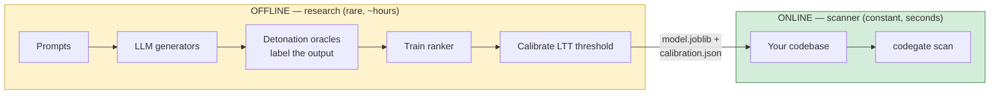
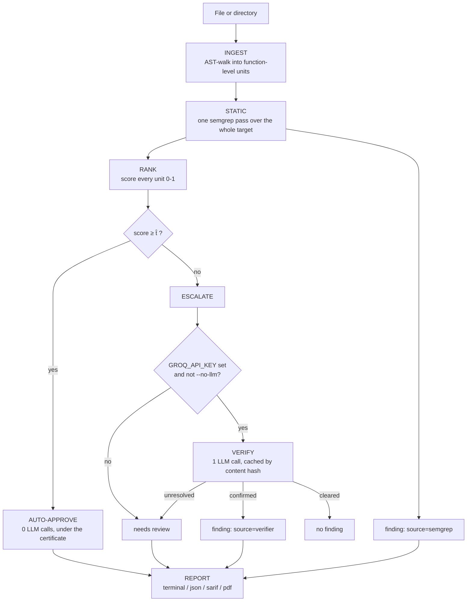

# CodeGate

**A certified-miss-rate security scanner for Python.** CodeGate escalates
code to an LLM only when it cannot mathematically prove the code is
safe — and it can tell you, with a real statistical guarantee, how often
it's wrong.

[](https://github.com/ad1tya-wq/codegate-scanner/actions/workflows/ci.yml)

---

## Table of contents

- [What CodeGate is](#what-codegate-is)
- [How it works, technically](#how-it-works-technically)
- [Quickstart](#quickstart)
- [Try it: the demo app](#try-it-the-demo-app)
- [High-level design](#high-level-design)
- [The scan pipeline](#the-scan-pipeline)
- [Current metrics](#current-metrics)
- [Future improvements](#future-improvements)
- [Project context](#project-context)

---

## What CodeGate is

Most AI-assisted code scanners force a bad trade-off. Either they're pure
static analysis — fast and free, but they miss anything that isn't a
known pattern — or they send *every* function to an LLM, which is slow,
expensive, and still just a probabilistic guess dressed up as an answer.

CodeGate does neither. It runs a cheap, deterministic pre-pass over your
code first, and only calls an LLM for the functions it genuinely cannot
vouch for. The part it *doesn't* escalate isn't a guess either — it comes
with a real, provable guarantee: **"at most 5% of what we auto-approved
is actually vulnerable, and we're 95% confident of that number."** That
guarantee is computed statistically, not asserted, and it holds no
matter what the underlying model looks like inside.

The result: static-analysis speed and cost for the code that's obviously
fine, LLM-level judgment reserved for the code that actually needs it,
and a number at the end you can defend instead of a vibe.

## How it works, technically

The certificate comes from **Learn-Then-Test (LTT) conformal risk
control** — a distribution-free, finite-sample method for choosing a
decision threshold with a provable risk bound. Concretely:

1. A lightweight ranker (`HashingVectorizer` + `LogisticRegression`,
   trained on labeled code samples) scores every function `0–1`, where
   higher means *safer*.
2. LTT runs fixed-sequence hypothesis testing over candidate thresholds
   `t`, where the risk `R(t) = P(score ≥ t | vulnerable)` is monotone in
   `t`. It certifies the most permissive threshold `t̂` such that
   `P(R(t̂) ≤ α) ≥ 1 − δ` — i.e. the true miss-rate at that threshold is
   below `α` with confidence `1 − δ`.
3. Any function scoring `≥ t̂` is auto-approved under that certificate.
   Anything below it is **escalated** — either to an LLM verifier (one
   call, JSON-structured, cached by content hash) or, without a key, left
   as "needs review."

This means the certificate's validity doesn't depend on the ranker being
good — a bad ranker just certifies a lower coverage (more gets
escalated), never a false guarantee. That's the actual point of using a
conformal method instead of just picking a threshold that "looks right"
on a validation set.

Three CWEs are tracked today: **CWE-89** (SQL injection), **CWE-78** (OS
command injection), **CWE-798** (hardcoded credentials) — chosen because
each has a reliable, automatable ground-truth signal (see
[Current metrics](#current-metrics)).

## Quickstart

```bash
git clone https://github.com/ad1tya-wq/codegate-scanner.git
cd codegate-scanner
pip install -e .
```

That's it — no Docker, no API key, no calibration run. The repo ships
with a pre-trained model and certificate at `data/model/`, so the tool
works immediately:

```bash
codegate info                              # what model/certificate is loaded
codegate scan path/to/your/project         # scan it (terminal output)
codegate scan path/to/your/project --format pdf --output report.pdf
```

Want the LLM verifier for escalated findings? Get a free key at
[console.groq.com](https://console.groq.com), then:

```bash
echo "GROQ_API_KEY=your-key-here" >> .env
codegate scan path/to/your/project         # LLM verification now runs automatically
```

No key (or `--no-llm`)? The scanner still runs everything else and marks
escalated findings "needs review" instead of crashing or silently
skipping them.

## Try it: the demo app

[`examples/vulnerable_app/`](examples/vulnerable_app/) is a small,
intentionally mixed target: each tracked CWE appears once as a
vulnerable function, sitting right next to its own direct fix, plus a
handful of unrelated safe functions with no security pattern at all.
It exists specifically to show CodeGate *discriminating* — not just
flagging everything.

```bash
codegate scan examples/vulnerable_app --no-llm
```

A pre-generated `examples/vulnerable_app/sample_report.pdf` is committed
in that directory, so you can see the actual PDF output without running
anything.

## High-level design

The project has two halves that share one artifact pair and otherwise
never touch each other.



**OFFLINE (research half, run rarely):** generates code from several
LLMs against a fixed prompt bank, labels each sample with *dynamic
detonation oracles* — the SQLi and cmdi oracles actually **execute** the
generated code in a sandbox and observe whether the exploit fires, which
is a stronger signal than any pattern match — trains the ranker, and
calibrates the LTT threshold. This is the only place in the whole
project that runs untrusted, LLM-generated code, and it's a deliberate,
contained choice (see
[docs/DESIGN_RATIONALE.md](docs/DESIGN_RATIONALE.md) for why that's safe).

**ONLINE (scanner half, run constantly):** takes the trained artifacts
as a fixed input and never executes anything it scans. This is the
`codegate` CLI everyone actually uses.

The two halves talk through exactly two files: `data/model/model.joblib`
and `data/model/calibration.json`. Retraining the offline half only ever
changes what's inside those two files — never a line of scanner code.

## The scan pipeline



Every finding is tagged with where it came from
(`semgrep` / `model` / `verifier`), which is what makes the report's
detection-attribution breakdown possible — you can see exactly how many
findings were deterministic pattern matches versus how many needed the
certified model or an LLM call.

## Current metrics

Generated by [`scripts/run_eval.py`](scripts/run_eval.py), which reads
whatever is in `data/model/` and re-runs unchanged once the real corpus
(see [Future improvements](#future-improvements)) replaces the
simulated one. Full numbers and PNGs land in `data/eval/` (gitignored —
regenerate locally with `python scripts/run_eval.py --with-llm`).

| Metric | Result | What it means |
|---|---|---|
| Oracle accuracy on ground-truth fixtures | **6/6** | The three oracles (SQLi, cmdi, creds) still agree with their own textbook examples |
| Corpus size / vulnerable rate / abstentions | **540 / 33.3% / 0** | Exactly the theoretically correct rate (1 of 3 prompt flavors is vulnerable), with zero unresolved labels |
| Ranker separation (ROC-AUC) | **1.00**¹ | The ranker cleanly separates vulnerable from safe scores on the current corpus |
| Certified threshold | **t̂ = 0.6613 @ α = 0.05, δ = 0.05** | At most 5% of what scores above this is vulnerable, with 95% confidence — *provisional, see below* |
| End-to-end scan vs. real ground truth, static + gate only | **precision 0.50, recall 1.00, F1 0.67** | Catches every real vulnerability in the demo app; also flags 3 safe functions the provisional model hasn't learned to clear yet |
| End-to-end scan vs. real ground truth, **with LLM verifier** | **precision 1.00, recall 1.00, F1 1.00** | The verifier corrects every one of the gate's false positives on the demo app, live-tested against Groq |

¹ **Caveat, stated plainly:** this AUC is computed on the full 540-sample
corpus, not a held-out split — `scores_r2.parquet` doesn't currently
carry which split a sample belongs to. On a small, templated simulated
corpus this reads as suspiciously perfect, which is a memorization
signal more than a generalization one. Don't repeat this number as "the
ranker's real accuracy" — see
[Future improvements](#future-improvements).

**The model backing every number above is still calibrated on a
simulated, not real, corpus** (`is_provisional: true`, visible in
`codegate info` and on every PDF's cover page). The *mechanism* is
verified end-to-end — the numbers themselves will change, not just
firm up, once the real corpus lands. See
`docs/ENGINEERING_LOG.md` section 6 for the full reasoning behind why
that's safe to build against in the meantime.

## Future improvements

- **Retrain on the real corpus** (the next and last blocking step) —
  swap `data/model/`'s artifacts for ones trained on real LLM-generated
  code instead of the simulated corpus, lift `is_provisional`, and
  re-run every metric above for real.
- **Held-out ranker evaluation** — thread the train/calib/test split
  label through to `scores_r2.parquet` so `ranker_separation_metrics`
  can be computed on test-only data, not the full corpus.
- **Choose a default `--alpha`** for the CLI from a real cost-coverage
  frontier, instead of only supporting the calibration-time value.
- **Published cost/token accounting**, backed by real Groq pricing
  (currently a placeholder — see `report/accounting.py`) and real
  per-call token usage from the API's own `usage` field, not just the
  chars/4 estimate.
- **Scale the corpus** from 540 to the original 1,620-sample target
  (3 generations per prompt) once the 540-sample loop has proven out on
  real data.
- **Broaden CWE coverage** beyond the current three, each requiring its
  own reliable ground-truth signal (dynamic detonation where possible,
  same standard as CWE-89/78 today).

See [`docs/DESIGN_RATIONALE.md`](docs/DESIGN_RATIONALE.md) for the
tech-stack rationale, the hurdles that shaped these decisions, and a
harder look at the project's novelty claims.

## Project context

Built for BCSE 497J (Project 1) at VIT by Linga Nikhil Arya, Aditya
Sahu, and Peter Isaac, guided by Dr. Dega Nagaraju. See
[`docs/ENGINEERING_LOG.md`](docs/ENGINEERING_LOG.md) for the full,
evidence-cited build history, and
[`docs/FUNCTION_REFERENCE.md`](docs/FUNCTION_REFERENCE.md) for a
per-function technical reference of the entire codebase.
