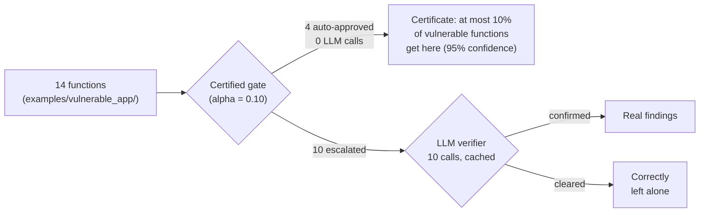

# CodeGate — Design Rationale

This document argues for the decisions behind CodeGate rather than
describing what was built (that's `ENGINEERING_LOG.md`) or how to call
each function (that's `FUNCTION_REFERENCE.md`). It exists to be read
skeptically — every section states a position and then argues it,
including the objections a reasonable reviewer would raise.

## Contents

1. [Tech stack, defended](#1--tech-stack-defended)
2. [Main hurdles](#2--main-hurdles)
3. [Future improvements](#3--future-improvements)
4. [Novelty and triage — points and counters](#4--novelty-and-triage--points-and-counters)

---

## 1 · Tech stack, defended

Every choice below was made against at least one plausible alternative.
This section states the alternative and why it lost.

### The ranker: `HashingVectorizer` + `LogisticRegression`, not a transformer

**The choice looks almost too simple for a security tool in 2026.**
That's deliberate, not a resource shortcut. Learn-Then-Test's guarantee
requires evaluating the risk function `R(t)` at every candidate
threshold during calibration — dozens to hundreds of evaluations over
the calibration set, every time `codegate calibrate` runs. A ranker that
is cheap and deterministic to score keeps that search tractable and
keeps *scan-time* inference near-free, which matters because the
certified gate has to score **every function in the target codebase**,
not a sample of it. A fine-tuned code transformer is a valid future
upgrade — LTT doesn't care what produces the score, only that scoring
is fast and the risk is monotone in the threshold — but it was correctly
deprioritized against getting the harder, load-bearing part right first:
accurate ground-truth labels. A better ranker trained on wrong labels is
still wrong; the project spent its effort where the actual risk was
(see [Hurdle 2](#hurdle-2-the-abstention-bug-that-hid-hurdle-1)).

### `scipy` for the actual statistics, not a hand-rolled bound

`gate/risk.py` and `gate/ltt.py` lean on `scipy.stats` (Clopper-Pearson
intervals, binomial tests) rather than an approximate or hand-derived
bound. The certificate this project's whole premise rests on is only as
trustworthy as the math underneath it — using a peer-reviewed,
widely-used statistics library for that math instead of custom
arithmetic is not a stylistic choice, it's the same logic as not
hand-rolling cryptography.

### `semgrep`, with a local custom ruleset, not the community registry alone

Static analysis needed a mature, battle-tested engine rather than a
from-scratch pattern matcher — semgrep is that, widely adopted, and
extensible. But the free community rule packs (`p/python`,
`p/security-audit`, `p/sql-injection`) were verified empirically
(2026-08-28) to produce **zero findings** against the project's own
raw-stdlib `sqlite3`/`subprocess` fixtures — they're tuned for framework
code (Django, Flask, SQLAlchemy), not the intraprocedural stdlib
patterns this project targets. The fix was a small, hand-written local
ruleset (`data/semgrep_rules/codegate_rules.yaml`) instead of accepting
the (silent, invisible) coverage gap. This also makes the static layer
fully offline — no registry fetch, no rate limits, no network
availability requirement for the primary detection path.

### `typer` + `rich`, not `argparse` or `click`

A typed, decorator-based CLI framework (`typer`) with a mature terminal
rendering library (`rich`) buys a real CLI — help text, validation,
tables, colored output — for very little boilerplate. `argparse` would
have meant hand-rolling all of that; `click` (which `typer` wraps) is
comparable but loses the type-hint-driven argument definitions that keep
`cli.py`'s command signatures self-documenting.

### `reportlab` + `pygments`, not an HTML-to-PDF pipeline

The report is a "major deliverable" per the project spec and needed to
be **fully deterministic** — no LLM writes report prose, and the
generation step itself needed no external binary dependency
(`wkhtmltopdf`, `pandoc`, a headless browser). `reportlab`'s Platypus
flowables plus `pygments`' tokenizer, hand-mapped into `reportlab`'s
restricted markup, produce syntax-highlighted, styled PDF output from
pure Python, with nothing to install beyond `pip`. The tradeoff — a
[real XML-escaping bug](#hurdle-5-the-reportlab-escaping-bug) surfaced
by this restricted-markup approach — was worth it for the zero-external-
dependency property; see that hurdle for how it was caught and fixed.

### Groq, as the verifier host — free tier, OpenAI-compatible, fast

The LLM verifier needed to be genuinely optional (the project must
degrade cleanly without any key) and cheap enough that a student project
can actually exercise it. Groq's free tier and OpenAI-compatible chat
completions API satisfy both, and its inference speed matters
specifically here: a verifier call sits in the scan's critical path per
escalated unit, so a slow provider would make `--no-llm` the only
practical mode. The OpenAI-compatible surface also means swapping
providers later (`scan/verifier.py::VerifierBackend` is a two-method
protocol) is a new backend class, not a redesign.

### GitHub Actions, not a self-hosted or third-party CI service

Free for a repo already hosted on GitHub, zero infrastructure to
maintain, and the two jobs that exist
(`test`, `clean-install-smoke`) need nothing beyond `pip install` and a
Python interpreter — no reason to reach for anything heavier. See
`ENGINEERING_LOG.md` section 9 for what the smoke job specifically
guards against.

---

## 2 · Main hurdles

Presented as the real defects found, in the order they mattered — each
one is cited to a commit, a test, or a live-verified command output in
`ENGINEERING_LOG.md`, not reconstructed from memory.

### Hurdle 1: the SQLi label bug

The vulnerable-flavor prompt template generated code that queried a
table named `t`; the detonation harness only ever created a table named
`users`. Every dynamic check raised `no such table: t`, the oracle
abstained, and — because of Hurdle 2 below — abstention silently became
"safe." The corpus *looked* fine (a plausible vulnerable rate, no
visible errors) while a full third of it was mislabeled. Found by
**measuring** the labeling pipeline's actual output distribution
(`dynamic_verdict={None: 540}` — literally every CWE-89 sample
abstained) rather than trusting that a run which completed without
exceptions had produced correct data.

### Hurdle 2: the abstention bug that hid Hurdle 1

`label_row` had no third state for "the oracle couldn't judge this" — a
`None` verdict collapsed to label `0` (safe). This is the actual root
cause: a systematically-abstaining oracle is statistically
indistinguishable from a systematically-safe corpus once abstention
isn't tracked as its own outcome. The fix introduced `LABEL_ABSTAIN` as
a real third value, excluded from training and calibration, with a
printed warning above a 20% abstention rate. This is also why
`corpus_label_distribution` (this project's eval module) reports
abstained counts as their own bar, not folded into "safe" — the same
lesson, now load-bearing in the eval tooling too.

### Hurdle 3: a clean install was completely broken, and nothing local ever caught it

`cli.py` imported the research pipeline eagerly at module level, which
transitively imported `matplotlib` — a dependency declared only under
the optional `research` extra. Every `codegate` command, including
`scan`, crashed with `ModuleNotFoundError` on a plain `pip install -e .`.
Every developer machine already had the `research` extra installed from
earlier setup, so this had been broken since whenever that import chain
was first written, invisibly, until setting up CI's clean-install job
forced a genuinely fresh environment to run the tool for the first
time. This is the strongest evidence in the project for *why* CI exists
at all — not as a checkbox, but because "works on every machine we
tested it on" and "works" are different claims.

### Hurdle 4: the verifier model was deprecated out from under the project — live, this session

`config.yaml` named `llama-3.3-70b-groq`, mapped internally to Groq's
`llama-3.3-70b-versatile`. Calling it 404'd. A direct
`GET /openai/v1/models` call against the same API key confirmed the
model simply isn't in Groq's current catalog anymore — no announcement
visible from inside the code, no deprecation warning, just gone. The
scanner's own degrade-safely design absorbed this without crashing
(a failed verifier call falls back to "needs review," never an
exception) — but the entire verification tier was silently non-functional
until the failure was diagnosed with a direct API probe, not inferred
from an error message. Fixed by remapping to `openai/gpt-oss-120b`,
verified live: it correctly classified a real vulnerable sample and
returned clean JSON on the first try. **The lesson generalizes**: any
external model dependency can be pulled out from under a project with
zero warning, and a system's job is to fail informatively (which this
one did) rather than to assume the dependency is eternal.

### Hurdle 5: the reportlab escaping bug

`report/pdf.py` interpolated `Finding` fields directly into `reportlab`
`Paragraph` text without XML-escaping them. Invisible on every test
fixture (ordinary identifiers like `get_user`), because
`scan/pipeline.py`'s own fallback for a module-level finding uses the
literal string `"<module>"` as a function name — and `reportlab`'s
restricted markup parser silently drops unrecognized tags. The rendered
PDF read `config.py:5 -- ()` instead of `config.py:5 -- <module>()`,
with no error anywhere. Caught only by opening the actual generated PDF
and reading it by eye, not by any automated test — the same lesson as
Hurdle 3, in miniature: an automated suite proves the code ran, not that
its output is correct. Fixed by escaping every dynamic string that
reaches a `Paragraph`, with a regression test asserting on the
`Paragraph`'s raw markup text directly (`reportlab` exposes it, so this
doesn't require rendering an actual PDF to catch a recurrence).

### Hurdle 6: cross-platform detonation payloads

The command-injection detonation harness originally used `;` to
separate its proof-of-exploit payload from the intended command — valid
POSIX shell syntax, but the development machine is Windows, where
`cmd.exe` doesn't accept it. Fixed to `&`, which both `cmd.exe` and
POSIX `sh` accept. A small fix, but a reminder that a security tool's
own test payloads are exactly the kind of code that needs to be
portable across the environments it might run in.

### Hurdle 7: no shared network between the two team machines for corpus generation

Track A's plan assumed both machines shared a LAN so one could host
Ollama for the other. They don't, and campus Wi-Fi client isolation
would likely have blocked it anyway. Resolved by inverting the design:
the host runs the entire generation step locally and ships back one
file (`generations.parquet`), rather than exposing an unauthenticated
inference server across a network boundary. Removes every networking
failure mode (firewall rules, `OLLAMA_HOST` binding, LAN reachability)
at the cost of the host needing Python and the repo, not just Ollama —
a trade made explicitly and documented in `docs/OLLAMA_SETUP.md`.

### Hurdle 8: the first real corpus certified nothing — and the cause was the labeller, not the data size

The first real corpus (516 samples, September 2026) produced no
certified threshold at any α up to 0.30: only 8 vulnerable samples
reached the calibration split. "Too little data" was the obvious reading
and the wrong one. Testing the oracles directly found four defects:
harnesses that called every function with a fixed number of arguments
(~44% of prompts could never be judged), a SQL check based on row counts
(injectable DELETEs labelled safe, safe `COUNT(*)` queries labelled
vulnerable), an entropy gate that rejected realistic passwords, and a base
model that wrote no vulnerable code at all. Re-labelling the *same* 516
samples after the fixes raised the vulnerable calibration count from 8 to
25 without generating anything. Only then was scaling worth paying for.
The lesson: when a statistical method says "not enough evidence", check
whether the evidence is being thrown away before asking for more of it.

### Hurdle 9: a resume feature that reused stale answers

The 2,160-sample generation run was written into a folder still holding
the previous run's checkpoint. Resume recognised finished samples by an
id built from the prompt id and the model, not the prompt's *wording*,
so it silently reused 404 old answers: 78 to prompts reworded since, 189
with a split reassigned since. Nothing errored, and the file looked
complete. Found by checking every sample's split against the prompt bank
and diffing code against the old corpus. Fixed by fingerprinting each
prompt's wording into the checkpoint. The corpus was repaired with a
committed, reproducible script, and then trimmed so all four models
answer exactly the same prompts.

### Hurdle 10: a labeller that called vulnerable code safe

Reading the full corpus by hand showed the credentials oracle labelling
51 of 60 vulnerable samples safe, with the planted secret sitting
verbatim in the code. It was in shapes the rules never reached: bytes
literals, (user, password) tuples, webhook URLs, connection strings.
Missed vulnerable labels are the dangerous direction for this project,
because they make the certificate report a lower miss rate than the
scanner really has. Every rule added was written test-first with a safe
twin, and was checked against every near-miss sample in three corpora.
All changed verdicts moved from SAFE to VULNERABLE, and no new false
positives appeared.

### Hurdle 11: a Windows-only success

All labelling ran on Windows. The first CI run of the new oracle code on
Linux showed every command-injection check failing. The helper that
supplies stand-ins for missing third-party modules had also faked
`msvcrt`, which Python's own `subprocess` imports to detect Windows, so on
Linux it took its Windows code path. Fixed by never faking a
standard-library module. No shipped label was affected, but the same
lesson as Hurdle 3 applies: "works on our machine" is not a result until
a clean, different environment agrees.

---

## 3 · Future improvements

Ranked roughly by how load-bearing they are to the project's central
claim (the certificate), not by how easy they are to build. Retraining on
real data, held-out ranker evaluation, scan-time `--alpha` and a
cluster-aware certificate were on this list and are done
(`ENGINEERING_LOG.md` §12–13).

1. **More task groups, not more samples per task.** The certificate counts
   each task group once, so tasks are what buy coverage. With 66
   vulnerable calibration groups, α = 0.05 certifies only 32% coverage.
2. **Better harness values for path- and directory-validated code.** 27%
   of safe command-execution samples still can't be judged, which loses
   exactly the hard negatives the ranker learns most from.
3. **Re-measure the live verifier on the real model**, and record real
   per-call token usage from the API's `usage` field instead of a
   characters ÷ 4 estimate against a placeholder price table.
4. **A code-embedding ranker.** The guarantee holds for any ranker; a
   better one buys more coverage at the same α.
5. **Broader CWE coverage.** Each additional CWE needs its own
   reliable, automatable ground-truth signal before it can be added —
   the project's standard (dynamic detonation where possible, a
   deterministic static rule otherwise) is what makes the certificate
   meaningful, and lowering that bar to cover more CWEs faster would
   directly undermine the thing this whole project argues for.

---

## 4 · Novelty and triage — points and counters

The claims this project actually makes, stated plainly, followed by the
strongest objection to each and the response.

### Claim: the guarantee is real, not a threshold picked to look good on a validation set

**Point.** LTT's certificate `P(R(t̂) ≤ α) ≥ 1 − δ` holds by
construction — it's a property of the fixed-sequence hypothesis test
over the calibration data, independent of how good the underlying
ranker is. A bad ranker certifies a *lower coverage* (more escalated,
fewer auto-approved) — it cannot produce a false guarantee, provided the
calibration samples are exchangeable with what the tool will see. This is
categorically different from picking a threshold that happened to score
well on a held-out set, which has no such property and can silently
stop generalizing the moment the input distribution shifts.

**Counter.** *"Isn't this just calling a normal ML threshold something
fancier?"* No — the distinction is falsifiable and this project actually
tests it: `research/eval/shift.py::run_shift_experiment` deliberately
calibrates on some generators and evaluates on a held-out one to check
whether the certificate survives a distribution shift, and
`test_run_shift_experiment_detects_certificate_break_under_severe_shift`
proves the framework *notices* when it doesn't hold, rather than
silently reporting a false guarantee. A "normal" threshold has no
mechanism to detect this at all. On the real corpus, calibrating on three
models and testing on the fourth's unseen data, three of four stay within
α = 0.10 (4.2%, 3.5%, 6.4%) and codegemma comes in at 10.5% (10 of 95, not
significant).

The honest limit of this claim is the exchangeability assumption itself,
and this project hit it. Four models answering the same task give
correlated samples, and the standard per-sample test was optimistic for
them: on held-out data its α = 0.10 threshold missed 13.4%. The shipped
certificate counts each task group once instead (Hoeffding–Bentkus over
per-group miss fractions). It stays within target on held-out data (9.3%
per task) and kept its promise in every simulated setting, where the
per-sample test broke it 7–18% of the time once samples correlate.

### Claim: the triage design is what makes LLM-based verification economically viable, not just accurate

**Point.** The real-world alternative to "escalate only what a
certificate can't clear" is either exhaustive LLM review (correct, but
doesn't scale to CI-pipeline latencies or costs) or static-analysis-only
(scales fine, but has no mechanism to bound what it's missing). On the
demo app, the shipped real-data model auto-approves 4 of 14 functions with
no LLM call at all, under a certificate that, averaged over tasks, at
most 10% of vulnerable functions get auto-approved. It escalates the other 10 to the verifier,
one cached call each. Static + gate alone already reaches recall 1.00,
with precision 0.27: every real vulnerability is caught, and most safe
code on this small target is escalated. The verifier's job is to clear those, and its effect on
this model has not been re-measured yet. On the earlier simulated model
it took precision from 0.50 to 1.00.

**Counter.** *"With only 14 functions, isn't this a toy example that
doesn't prove anything about scale?"* Fair, and stated as such — this is
a demonstration on a small, hand-built target with known ground truth,
not a claim about a 10,000-function monorepo. What *does* generalize is
the mechanism: the fraction requiring an LLM call is exactly the
fraction the certificate can't clear, and that fraction is a property of
the ranker's quality and `alpha`, not of codebase size. On the real
corpus's calibration data the shipped threshold auto-approves 50% of
functions, so a larger codebase like it would see roughly half escalated.
That is the actual cost claim: bounded LLM spend as a function of
`alpha`, not of lines of code.

### Claim: dynamic detonation labels are stronger ground truth than pattern-matching alone

**Point.** The SQLi and cmdi oracles don't just look for suspicious
syntax — they execute the generated code against a real (sandboxed)
database/subprocess call and observe whether the exploit payload
actually fires. This is why Hurdle 1 was catchable at all: a
pattern-matching oracle would have "detected" the vulnerable-flavor
samples regardless of the table-name bug, and the mislabeling would
never have surfaced.

**Counter.** *"Executing LLM-generated code is inherently risky — isn't
this the exact anti-pattern the industry tells you to avoid?"* It would
be, if it ran on user-scanned code. It doesn't: this execution is
strictly confined to the OFFLINE research half, on a machine the team
controls, against code the team's own prompts generated — never on a
scan target (`scan/pipeline.py::run_scan`'s docstring states this as a
hard invariant, and
`test_scan_never_executes_the_scanned_code` proves it with a
sentinel-file check, not just an assertion by inspection). The threat
model for that execution is *benign accident* (an LLM writing code that
happens to do something unexpected), not an adversary crafting
malicious generator output — a distinction the project's own decision
log states explicitly as the reason full containerization was deferred
rather than treated as a blocking requirement.

### Claim: the honesty discipline (provisional flags, degrade-without-keys, explicit estimate flags) is itself part of the contribution

**Point.** A certificate that doesn't disclose when it isn't
trustworthy yet is worse than no certificate — it's exactly the failure
mode a "certified miss-rate" tool exists to prevent, applied to itself.
`calibration.json` carries `is_provisional` as a field in the artifact,
not a comment; `codegate info` and every PDF cover page surface it;
`CostSummary.is_estimate` is a real field a report renderer must read,
not a docstring note it could silently drop; `--alpha` accepts only α
values LTT actually certified and refuses the rest with the list of valid
ones, rather than interpolating a threshold that would carry no
guarantee.

**Counter.** *"Isn't 'our numbers are provisional' just an excuse for
not having finished the project?"* For most of the build the model was
calibrated on a simulated corpus and flagged provisional, while the
mechanism was fully built and verified against a live LLM endpoint. The
flag was lifted only when a real corpus certified, in October 2026, and
the same discipline continues past that point. When the held-out data
showed the standard certificate overshooting, it was replaced with a
stricter cluster-aware one at the cost of coverage, the verifier figures
are marked "not yet re-measured" rather than carried over from the
simulated model, and the shipped α is 0.10 because that is what the honest
certificate supports with useful coverage. A confident-looking number nobody should trust is the
specific failure this project's design exists to prevent, and that
applies to its own headline too.
